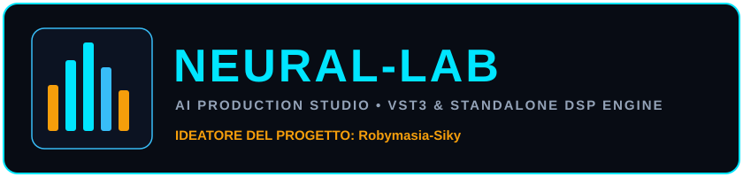



# Manuale d'Uso Ufficiale — NEURAL-LAB

**Ideatore del Progetto:** **Robymasia-Siky**

## 1. Avvio Rapido
- **Standalone:** Avvia `NEURAL LAB.exe` (il motore Python/Ollama parte in automatico su `ONLINE`).
- **VST3:** Copia `NEURAL LAB.vst3` in `C:\Program Files\Common Files\VST3\` e caricalo su Ableton Live.

## 2. Chat Copilot Scrollabile & Comandi AI
- **Campo Prompt:** Scrivi richieste musicali, consigli di mixing o comandi per Ableton Live.
- **GENERATE TRACK / ARRANGE FULL:** Seleziona e combina i migliori sample dalle cartelle indicizzate.
- **ASK / MIDI:** Risponde alle domande o crea clip MIDI/tracce su Ableton Live.
- **AUTO MASTER:** Calibra automaticamente il master sulla Reference.
- **Slider Chat:** Usa la rotellina del mouse o lo slider destro per scorrere tutte le risposte precedenti.

## 3. Sample CLAP & Reference A/B (`> REF` / `|| REF`)
- **+ SAMPLE FOLDER:** Indicizza WAV/AIFF con Audition (`>`), Lock (`L`) e Swap (`S`).
- **LOAD REFERENCE & > REF:** Traccia la **REF TARGET EQ CURVE** e attiva il pre-ascolto istantaneo A/B.

## 4. Rack DSP
- **SUB CLEAN (Hz):** Filtro passa-alto (20–250 Hz).
- **NEURAL PUNCH:** Esaltazione transienti (0–100%).
- **STEREO WIDTH:** Ampiezza stereo Mid/Side (0–200%).
- **INPUT DRIVE (dB):** Saturazione armonica (-12 a +12 dB).
- **EQ MATCH (%):** Adattamento timbrico sulla Reference.
- **MASTER CEILING (dB):** Limiter brickwall finale con misuratori LUFS e GR.

## 5. Ableton Live MCP (`MCP: ON/OFF`)
Con `MCP: ON` controlla Ableton Live via AbletonOSC (porta `11000`) in linguaggio naturale.

---
**NEURAL-LAB — Ideato e realizzato da Robymasia-Siky**
