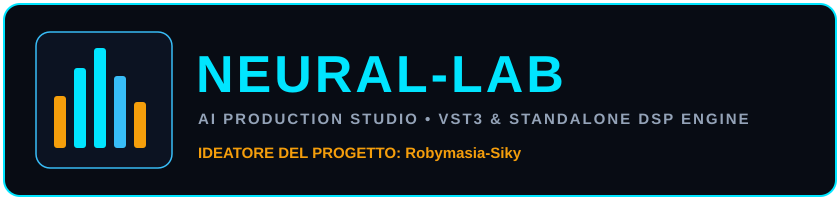



<h1 align='center'>NEURAL-LAB — Next-Gen AI Music Production Studio &amp; DSP Engine</h1>

<strong>Ideato, progettato e sviluppato da <a href='https://github.com/robymasia-Siky'>Robymasia-Siky</a></strong> <em>Plugin VST3 &amp; Standalone che unisce DSP audio professionale in tempo reale (C++20/JUCE), Intelligenza Artificiale 100% locale (Ollama + LAION-CLAP), Reference A/B, Auto-Mastering adattivo e controllo diretto di Ableton Live tramite MCP.</em>

   

---

## 🎯 Perché NEURAL-LAB
- **Zero Cloud, Zero Abbonamenti, 100% Locale:** Tutti i modelli AI girano sul tuo PC tramite **Ollama** e **PyTorch/ONNX**. I tuoi progetti inediti restano sempre privati.
- **Latenza Audio Zero:** Motore DSP nativo in **C++20 / JUCE** separato dal backend neurale Python tramite bus **OSC UDP (9001/9002)** con avvio istantaneo (< 0.5s).
- **Dall'Idea al Master Finale:** Cerca sample per descrizione timbrica, crea clip MIDI su Ableton Live, confronta la traccia di riferimento in A/B e finalizza con EQ Match e Brickwall Limiter.

## 🚀 Funzionalità Principali
| Modulo | Descrizione | Stack Tecnico |
| :--- | :--- | :--- |
| **💬 AI Copilot Chat Scrollabile** | Assistente di produzione e mixing nell'interfaccia *Obsidian Glass* con word-wrap e storico scrollabile. | Ollama • 
eural-lab-0.5b • JUCE |
| **🎛️ Ableton Live MCP Bridge** | Controllo diretto di tracce MIDI, note, BPM, rinomina canali e volumi su Ableton Live (MCP: ON/OFF). | AbletonOSC • qwen2.5-coder:3b • UDP 11000 |
| **🔍 Sample Indexer Semantico** | Scansione cartelle (+ SAMPLE FOLDER) con selezione intelligente di Kick, Bass, Synth, Perc + **Audition / Lock / Swap**. | LAION-CLAP • PyTorch |
| **🎧 Reference Track & A/B (> REF)** | Curva **REF TARGET EQ CURVE** sovrapposta allo spettro a 64 bande e pre-ascolto istantaneo A/B (> REF / || REF). | AudioTransportSource • FFT |
| **⚡ Auto-Mastering & Rack DSP** | SUB CLEAN (Hz), NEURAL PUNCH, STEREO WIDTH, INPUT DRIVE (dB), EQ MATCH (%), MASTER CEILING (dB) + **LUFS / GR**. | C++20 DSP • Mid/Side • Matchering |

## 💻 Avvio Rapido
1. **Standalone:** Avvia `NEURAL LAB.exe` (il motore AI e Ollama si avviano automaticamente su `NEURAL-LAB ENGINE: ONLINE`).
2. **Plugin VST3:** Copia `NEURAL LAB.vst3` in `C:\Program Files\Common Files\VST3\` e caricalo sul Master o su un bus di Ableton Live.

## 📖 Documentazione & Crediti
- Consulta il **[Manuale d'Uso Completo (MANUALE_USO.md)](MANUALE_USO.md)** per tutti i dettagli operativi.
- **Ideatore e Autore del Progetto:** **[Robymasia-Siky](https://github.com/robymasia-Siky)**
